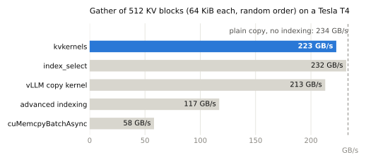

# kvkernels

Triton kernels for the KV cache of LLM inference: paged KV block gather and
scatter, and shared-prefix (cascade) decode attention, on the KV cache layouts
vLLM and SGLang use.

## Install

```bash
pip install kvkernels
```

Needs torch 2.13+ and, on Linux, Triton 3.7+, so it installs next to vLLM 0.32.0
or SGLang 0.5.22. Supports Python 3.11+ and NVIDIA GPUs of compute capability
7.5 to 9.0.

## What it does

**Gather and scatter KV blocks.** Copy a request's scattered KV blocks into one
contiguous buffer, before offloading them or sending them to another GPU, and
back. Raw bytes, so every dtype works, on every vLLM and SGLang layout.

```
paged KV cache   │ 0 │ 1 │ 2 │ 3 │ 4 │ 5 │ 6 │ 7 │ …
                       ▲               ▲   ▲
staging buffer   │ 5 │ 1 │ 6 │                       gather_kv_blocks(planes, [5, 1, 6], staging)
```

**Decode with a shared prefix.** When requests share a prefix (a system prompt),
the cascade reads its K and V once for the whole batch, reads each request's own
suffix once, and merges the two results exactly.

```
             shared prefix              own suffix
request 0    ████████████████████████   ░░          ─┐
request 1    ████████████████████████   ░░░░░        ├─▶ merge ─▶ out
request 2    ████████████████████████   ░░░░░░░░░   ─┘
             └── read once for all ─┘   └ per request ┘

plan.plan_from_block_table(block_table, seq_lens)   # each step, on the GPU: finds the prefix
cascade_decode_attention(q, k, v, plan, out)        # each layer
```

Runnable versions: [examples/gather.py](examples/gather.py),
[examples/cascade.py](examples/cascade.py). Every op writes into tensors the
caller provides, can be captured in a CUDA graph, and has a PyTorch reference in
`kvkernels.reference`.

## Results

Every chart comes from one benchmark run, which records the GPU and software
versions. All numbers: [results/README.md](results/README.md).

### KV block gather

<!-- results:kv_gather:begin -->
On a NVIDIA L4, kvkernels gathers 4,096 KV blocks from vLLM's default layout at 240 GB/s, 102% of the GPU's measured copy bandwidth (index_select 243 GB/s, vLLM copy kernel 237 GB/s, cuMemcpyBatchAsync 60 GB/s).

<picture><source media="(prefers-color-scheme: dark)" srcset="figures/l4/kv_gather-dark.svg"></picture>

<sub>NVIDIA L4, torch 2.14.1+cu126, Triton 3.8.0, commit <code>dirty-de4213be</code>; from <code>results/l4/kv_gather/20261115T000021Z.json</code></sub>

On a Tesla T4, kvkernels gathers 512 KV blocks from vLLM's default layout at 223 GB/s, 94% of the GPU's measured copy bandwidth (index_select 232 GB/s, vLLM copy kernel 213 GB/s, cuMemcpyBatchAsync 58 GB/s).

<picture><source media="(prefers-color-scheme: dark)" srcset="figures/t4/kv_gather-dark.svg"></picture>

<sub>Tesla T4, torch 2.14.1+cu126, Triton 3.8.0, commit <code>dirty-615f2a83</code>; from <code>results/t4/kv_gather/20261031T051548Z.json</code></sub>
<!-- results:kv_gather:end -->

### Cascade decode attention

<!-- results:cascade:begin -->
One decode step of one layer: Llama 3.1 8B attention (32 query heads, 8 KV heads, head_dim 128), one shared prefix of 8,192 tokens, a 512-token suffix per request, vLLM's layout with 16-token KV blocks, fp16. Median time; bandwidth counts the bytes a cascade needs (the prefix read once).

| Batch | kvkernels (µs) | FlashInfer decode (µs) | FlashInfer cascade (µs) | speedup over FlashInfer decode | kvkernels, share of datasheet bandwidth |
|---|---|---|---|---|---|
| 1 | 195.6 | 151.6 | 165.9 | 0.77x | 61% |
| 4 | 190.5 | 181.2 | 193.5 | 0.95x | 73% |
| 16 | 510.0 | 611.3 | 291.8 | 1.20x | 44% |
| 32 | 646.1 | 1275.9 | 434.2 | 1.97x | 52% |
| 64 | 926.7 | 2392.1 | 716.8 | 2.58x | 60% |
| 128 | 1852.4 | 5115.4 | 1403.9 | 2.76x | 54% |

<sub>NVIDIA L4, torch 2.14.1+cu126, Triton 3.8.0, commit <code>dirty-de4213be</code>; from <code>results/l4/cascade/20261115T042026Z.json</code></sub>
<!-- results:cascade:end -->

## Limitations

- On the T4 (compute capability 7.5), Triton uses no tensor cores, so the
  attention ops are correct but slower than FlashInfer there.
- Decode only; no prefill kernels.
- Outside a CUDA graph, each call costs tens of microseconds of CPU time.

## Development

On macOS, use the devcontainer; Triton runs on Linux only.

```bash
make install && make test && make lint     # CPU, under the Triton interpreter
make install-cu130 && make test-gpu        # on a GPU machine
uv run python scripts/gpu_session.py run --out session/   # every GPU step, with logs
```

`scripts/kaggle_session.py` runs the GPU session on a free Kaggle T4.

## License

[Apache License 2.0](LICENSE)
