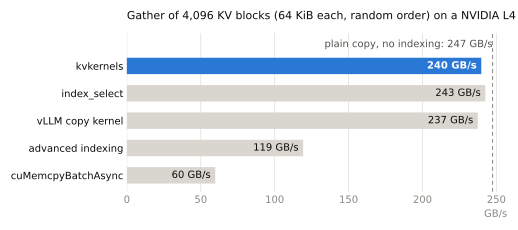
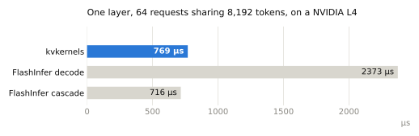
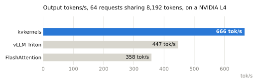

# kvkernels

Triton kernels for the KV cache of LLM inference: paged KV block gather and
scatter, and shared-prefix (cascade) decode attention, on the KV cache layouts
vLLM and SGLang use.

## Install

```bash
pip install kvkernels
```

Needs torch 2.13+ and, on Linux, Triton 3.7+, so it installs next to vLLM 0.32.0
or SGLang 0.5.22. Supports Python 3.11+ and NVIDIA GPUs of compute capability
7.5 to 9.0.

## What it does

**Gather and scatter KV blocks.** Copy a request's scattered KV blocks into one
contiguous buffer, before offloading them or sending them to another GPU, and
back. Raw bytes, so every dtype works, on every vLLM and SGLang layout.

```
paged KV cache   │ 0 │ 1 │ 2 │ 3 │ 4 │ 5 │ 6 │ 7 │ …
                       ▲               ▲   ▲
staging buffer   │ 5 │ 1 │ 6 │                       gather_kv_blocks(planes, [5, 1, 6], staging)
```

**Decode with a shared prefix.** When requests share a prefix (a system prompt),
the cascade reads its K and V once for the whole batch, reads each request's own
suffix once, and merges the two results exactly.

```
             shared prefix              own suffix
request 0    ████████████████████████   ░░          ─┐
request 1    ████████████████████████   ░░░░░        ├─▶ merge ─▶ out
request 2    ████████████████████████   ░░░░░░░░░   ─┘
             └── read once for all ─┘   └ per request ┘

plan.plan_from_block_table(block_table, seq_lens)   # each step, on the GPU: finds the prefix
cascade_decode_attention(q, k, v, plan, out)        # each layer
```

The plan finds shared prefixes on the GPU from the engine's block table or slot
list, so a decode step stays one CUDA graph. Prefixes may nest (a system prompt
shared by every request, a document shared by some), a request may bring up to
16 new tokens (speculative decoding), and K and V may be fp16, bf16 or fp8.
A `PlaneSet` gathers or scatters the same KV blocks in every layer's K and V
in one launch, to or from pinned host memory.

Runnable versions: [examples/gather.py](examples/gather.py),
[examples/cascade.py](examples/cascade.py). Every op writes into tensors the
caller provides, can be captured in a CUDA graph, and has a PyTorch reference in
`kvkernels.reference`.

## Results

Every chart comes from one benchmark run, which records the GPU and software
versions. All numbers: [results/README.md](results/README.md).

### KV block gather

<!-- results:kv_gather:begin -->
On a NVIDIA L4, kvkernels gathers 4,096 KV blocks from vLLM's default layout at 240 GB/s, 102% of the GPU's measured copy bandwidth (index_select 243 GB/s, vLLM copy kernel 237 GB/s, cuMemcpyBatchAsync 60 GB/s).

<picture><source media="(prefers-color-scheme: dark)" srcset="figures/l4/kv_gather-dark.svg"></picture>

<sub>NVIDIA L4, torch 2.14.1+cu126, Triton 3.8.0, commit <code>dirty-de4213be</code>; from <code>results/l4/kv_gather/20261115T000021Z.json</code></sub>

On a Tesla T4, kvkernels gathers 512 KV blocks from vLLM's default layout at 223 GB/s, 94% of the GPU's measured copy bandwidth (index_select 232 GB/s, vLLM copy kernel 213 GB/s, cuMemcpyBatchAsync 58 GB/s).

<picture><source media="(prefers-color-scheme: dark)" srcset="figures/t4/kv_gather-dark.svg"></picture>

<sub>Tesla T4, torch 2.14.1+cu126, Triton 3.8.0, commit <code>dirty-615f2a83</code>; from <code>results/t4/kv_gather/20261031T051548Z.json</code></sub>
<!-- results:kv_gather:end -->

### Cascade decode attention

<!-- results:cascade:begin -->
On a NVIDIA L4, one layer of Llama 3.1 8B decodes 64 requests that share an 8,192-token prefix in 769 µs with kvkernels (FlashInfer's decode 2373 µs, FlashInfer's cascade 716 µs).

<picture><source media="(prefers-color-scheme: dark)" srcset="figures/l4/cascade-dark.svg"></picture>

<sub>NVIDIA L4, torch 2.14.1+cu126, Triton 3.8.0, commit <code>dirty-78a1d416</code>; from <code>results/l4/cascade/20261118T213405Z.json</code></sub>
<!-- results:cascade:end -->

### Serving in vLLM

The cascade as vLLM's decode attention backend, through the plugin in
[integrations/vllm](integrations/vllm), measured with vLLM's serving benchmark
and GSM8K.

<!-- results:serving:begin -->
On a NVIDIA L4, vLLM 0.33.0 serving Llama-3.1-8B-Instruct with a KV cache in the model's dtype and kvkernels for decode attention produces 666 output tokens/s when 64 requests share an 8,192-token document (+49% over vLLM Triton, +86% over FlashAttention). With nothing shared it is within 0.6% of vLLM's backends; GSM8K kvkernels 70.4%, vLLM Triton 70.1%, FlashAttention 70.6%.

<picture><source media="(prefers-color-scheme: dark)" srcset="figures/l4/serving-dark.svg"></picture>

<sub>NVIDIA L4, torch 2.14.0+cu130, Triton 3.8.0, commit <code>dirty-d2c71359</code>; from <code>results/l4/serving/20261117T224727Z.json</code></sub>

On a NVIDIA L4, vLLM 0.33.0 serving Llama-3.1-8B-Instruct with an fp8 KV cache and kvkernels for decode attention produces 680 output tokens/s when 64 requests share an 8,192-token document (+38% over vLLM Triton). With nothing shared it is within 1.2% of vLLM's backends; GSM8K kvkernels 71.0%, vLLM Triton 69.8%.

<sub>NVIDIA L4, torch 2.14.0+cu130, Triton 3.8.0, commit <code>dirty-78a1d416</code>; from <code>results/l4/serving/20261118T233456Z.json</code></sub>
<!-- results:serving:end -->

## Limitations

- Tested on the T4 (compute capability 7.5) and L4 (8.9). The A100 (8.0) and
  H100 (9.0) are supported but have not run the tests.
- On the T4, Triton uses no tensor cores, so the attention ops are correct but
  slower than FlashInfer there.
- Decode only; no prefill kernels.
- fp8 KV is e4m3 with one scale for K and one for V per layer, and needs
  compute capability 8.9 or later (L4, RTX 4090, H100): Triton has no e4m3
  type below it.
- The vLLM backend supports vLLM 0.33.0 only and installs from this repository.
- Outside a CUDA graph, each call costs tens of microseconds of CPU time.

## Development

On macOS, use the devcontainer; Triton runs on Linux only.

```bash
make install && make test && make lint     # CPU, under the Triton interpreter
make install-cu130 && make test-gpu        # on a GPU machine
uv run python scripts/gpu_session.py run --out session/   # every GPU step, with logs
```

`scripts/kaggle_session.py` runs the GPU session on a free Kaggle T4.

## License

[Apache License 2.0](LICENSE)
